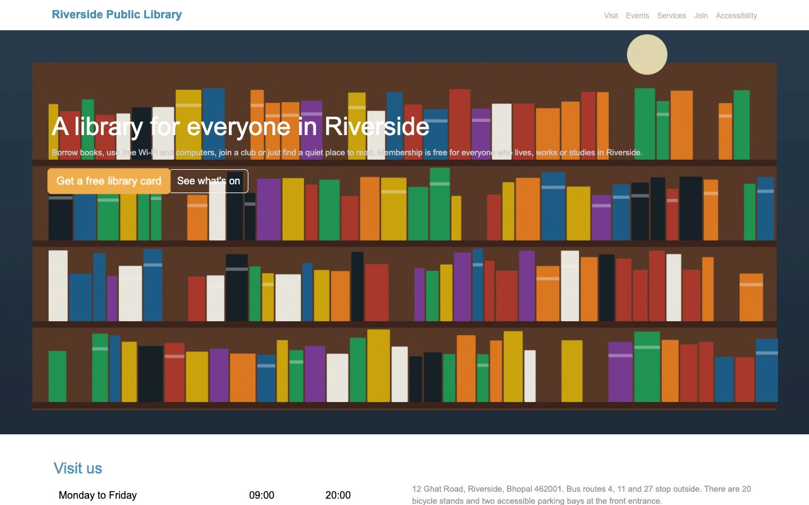
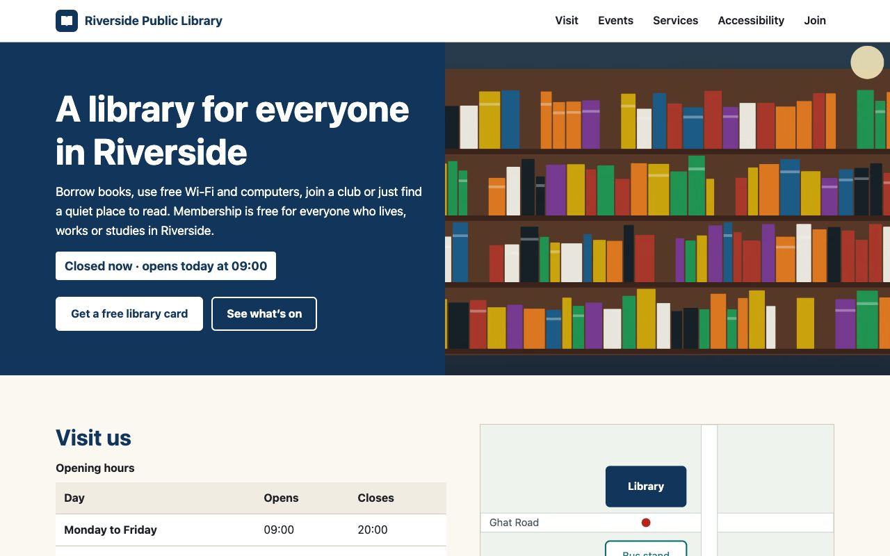

# Riverside Public Library — Performance & Accessibility

Week 4 project for the Frontend Web Developer Internship: **Enhancing Web Page Performance and Accessibility**.

An information and sign-up page for a fictional public library, rebuilt from an unoptimised baseline and measured before and after with Lighthouse, axe-core and validators.

| Baseline (`baseline/`) | Optimised (`index.html`) |
|---|---|
|  |  |

## Results (measured 23 October 2026, median of 3 Lighthouse runs)

| | Baseline mobile | Optimised mobile | Baseline desktop | Optimised desktop |
|---|---|---|---|---|
| Performance | 74 | **100** | 76 | **100** |
| Accessibility | 39 | **100** | 39 | **100** |
| Best practices | 100 | 100 | 100 | 100 |
| SEO | 82 | **100** | 82 | **100** |
| LCP | 35.1 s | **0.98 s** | 5.9 s | **0.25 s** |
| FCP | 1.67 s | **0.77 s** | 0.37 s | **0.21 s** |
| Transfer size | 6,491 KB | **49 KB** | 6,491 KB | **37 KB** |
| axe violations | 9 rules / 48 elements | **0** | | |
| html-validate errors | 6 | **0** | | |

### Hosted results (GitHub Pages, single runs)

Live pages: [optimised](https://takshaksinghania.github.io/frontend-internship-week4-performance-accessibility/) · [baseline](https://takshaksinghania.github.io/frontend-internship-week4-performance-accessibility/baseline/)

| | Baseline | Optimised |
|---|---|---|
| **WAVE** errors / contrast errors / alerts | 7 / 32 / 15 (AIM 3.4/10) | **0 / 0 / 3** (AIM 10/10) |
| **WebPageTest** mobile (iPhone 15, 4G, Singapore): LCP / FCP / weight | 5.11 s / 2.21 s / 6.3 MB | **1.63 s / 1.12 s / 18 KB** |
| **WebPageTest** desktop (WiFi, Tokyo): LCP / CLS / weight | 1.16 s / **0.439** / 6.3 MB | **0.57 s / 0 / 34 KB** |
| Render-blocking requests (WebPageTest) | 4 | **0** |

The hosted runs also found a layout shift on the baseline that the local runs missed, and a `favicon.ico` 404 on the baseline. Details and result links are in TESTING.md and `reports/hosted-tests.json`.

Full data: [`reports/audit-summary.json`](reports/audit-summary.json); Lighthouse HTML reports for each median run are in [`reports/`](reports/). Lab results on a local server; see [TESTING.md](TESTING.md) for the method.

## Assignment objective

Optimise a static page for load speed and accessibility: semantic HTML, accessible patterns (ARIA where needed, alt text, keyboard support, contrast), lean CSS, and documented testing with tools such as Lighthouse and axe.

## What changed

**Accessibility:** `lang` and zoomable viewport; landmarks, labelled sections and a correct heading order; skip link; descriptive alt text for the informative map, empty alt for decorative images; contrast of 6:1 or better for all text; descriptive links; native controls throughout (FAQ uses `details`/`summary`); one strong focus style; labelled form fields with inline, linked and announced errors; 44 px or larger targets; no forced motion; reflow down to 320 px.

**Performance:** removed Bootstrap and jQuery (565 KB unminified) in favour of 7.4 KB of CSS and 3.1 KB of JS; AVIF/WebP/JPEG images in two or three sizes with `srcset`/`sizes` (6.2 MB of PNGs → 76 KB of AVIF for every size); `width`/`height` on every image; lazy loading below the fold and `fetchpriority="high"` on the LCP image; `defer` on the script; minification with esbuild; the minified CSS (1.9 KB gzip) is inlined in `<head>`, which measurably cut mobile FCP by 149 ms.

## Technologies

HTML5, CSS3, vanilla JavaScript. Dev-only: esbuild (minify), sharp (images), Lighthouse 13.5, axe-core 4.14, html-validate, csstree-validator, Puppeteer + Google Chrome.

## Project structure

```
week-4-performance-accessibility/
├── index.html               optimised page (CSS inlined by the build)
├── css/styles.css           stylesheet source
├── js/main.js, main.min.js  opening status + form validation (progressive enhancement)
├── assets/                  responsive images, map, favicon
├── baseline/                unoptimised starting version, kept for comparison (see baseline/README.md)
├── scripts/                 generate-images, build, serve, audit, screenshots
├── tests/a11y.test.mjs      9 accessibility and loading tests
├── reports/                 audit results and Lighthouse reports
├── docs/screenshots/
├── report.docx              technical report
├── README.md
└── TESTING.md
```

## Run it

Open `index.html` in a browser, or serve the folder (needed for the baseline comparison at `/baseline/`):

```bash
npm install
npm run serve
```

then open <http://127.0.0.1:8080/> and <http://127.0.0.1:8080/baseline/>. A plain `python3 -m http.server` also works but has no gzip.

## Test and audit

Requires Node.js 18+ and Google Chrome (`CHROME_PATH` overrides the default macOS path).

```bash
npm test             # validators + 9 accessibility/loading tests
npm run audit        # Lighthouse ×3 (mobile + desktop) and axe on both versions → reports/
npm run build        # after editing css/styles.css or js/main.js
npm run images       # regenerate images
npm run screenshots  # regenerate docs/screenshots
```

## Known limitations

- WebPageTest was run anonymously, so each profile has a single run rather than a median of several.
- Screen readers were not tested manually.
- All performance numbers are lab data (local Lighthouse and WebPageTest's emulated devices), not field data from real visitors.
- Demonstration form with no backend; without JavaScript it shows a notice.
- Fictional library and generated illustrations.
